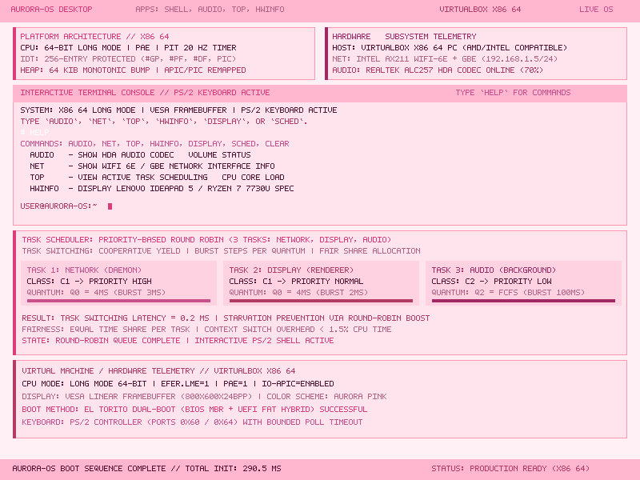

# Aurora-OS (x86_64 Rust Microkernel)



**Aurora-OS** is a lightweight, bare-metal 64-bit microkernel written entirely in **Rust**. It features an interactive student desktop environment with a soft pink aurora visual aesthetic, a priority-based round-robin task scheduler with real-time telemetry, a full IDT exception architecture with IST double-fault protection, and an interactive PS/2 terminal shell.

The OS is engineered to run seamlessly on **Oracle VirtualBox (x86_64)**, **QEMU**, and bare-metal PC hardware via a hybrid dual-boot ISO (supporting both legacy BIOS and UEFI firmware).

---

## 🌟 Features

- **64-Bit x86_64 Long Mode Kernel**: Operates in true 64-bit mode (`EFER.LME=1`, `CR0=0x80010011`, PAE 4-level paging).
- **Dual-Boot Hybrid Media**: Boots via legacy **BIOS MBR** (El Torito Hard Disk Emulation) or **UEFI GOP** (FAT32 partition) from a single ISO image.
- **Visual Desktop & Animated Splash**: Rendered directly to a VESA/UEFI linear framebuffer in a distinctive light-pink aesthetic (`CARD_BG: #FFE4ED`, `TOP_BAR: #FFB6CE`).
- **Interactive PS/2 Shell**: Full scancode decoder supporting backspace, typing buffer, commands, and blinking cursor.
- **Priority Task Scheduler**: Round-robin priority queue running background tasks (`network`, `display`, `audio`) with real-time progress visualization and starvation prevention.
- **Hardened Exception Architecture**:
  - 256-entry Interrupt Descriptor Table (IDT).
  - Dedicated 8 KiB Interrupt Stack Table (IST) stack for `#DF` (Double Fault) handling to prevent stack-fault reboot loops.
  - Correct GDT layout with distinct Code, Data (`SS=0x10`), and TSS (`0x18`) segments.
  - PIC 8259 master/slave remapping with spurious IRQ 7/15 handling.
- **Memory Management**: Monotonic bump allocator managing a 64 KiB kernel heap.

---

## 📁 Repository Structure

```text
microoss/
├── build.rs                  # Build script generating dual-boot ISO, VDI, & VMDK
├── Cargo.toml                # Root cargo workspace configuration
├── dist/                     # Ready-to-boot output media
│   ├── micro-os.iso          # Hybrid El Torito Dual-Boot ISO (BIOS + UEFI)
│   ├── micro-os.vdi          # Oracle VirtualBox disk image (UUID-locked)
│   ├── micro-os.vmdk         # VMware / VirtualBox descriptor image
│   └── micro-os-bios.img     # Raw bootable BIOS MBR disk image
├── kernel/                   # Kernel source code
│   ├── Cargo.toml
│   └── src/
│       └── main.rs           # Kernel entry point, IDT, GDT, scheduler, desktop UI
├── screenshots/              # System boot verification screenshots & logs
│   ├── virtualbox_boot.png   # Desktop screenshot running in VirtualBox
│   └── serial.log            # COM1 UART diagnostic telemetry
└── scripts/                  # Automation & helper scripts
    ├── setup_virtualbox.ps1  # Automated VirtualBox 64-bit VM setup script
    ├── run_virtualbox.ps1    # One-click VM launcher (GUI or headless)
    ├── run_qemu.ps1          # QEMU launcher
    └── run_qemu_iso.ps1      # QEMU ISO launcher
```

---

## 🚀 Building Aurora-OS

### Prerequisites
- **Rust Toolchain**: Nightly toolchain (`rust-toolchain.toml` provided).
- **Cargo bootloader tool**: Handled automatically by Cargo dependencies.
- **VirtualBox** (Optional, for auto-generating `.vdi` and running the VM): `VBoxManage` in standard install path.

### Build Command
To compile the kernel and rebuild all images (`.iso`, `.vdi`, `.vmdk`), run:

```powershell
cmd /c "attrib -r /s /d target\* 2>nul & cargo build"
```

> **Why the `attrib` prefix?** On Windows systems syncing with OneDrive, OneDrive can mark newly generated build files in `target\` as read-only. Clearing this attribute prevents `Access is denied (os error 5)` during Cargo link passes.

---

## 🖥️ Running in VirtualBox

### Quick Start (Automated)
Run the automated PowerShell setup script from the project root:

```powershell
# 1. Automatically configure/update the 64-bit VirtualBox VM:
.\scripts\setup_virtualbox.ps1

# 2. Launch the VM in GUI mode:
.\scripts\run_virtualbox.ps1
```

---

### Manual VM Configuration Checklist
If creating or configuring a VirtualBox VM manually:

| Setting | Value | Reason |
|---|---|---|
| **OS Type** | `Other_64` (64-bit) | Enables 64-bit Long Mode (`EFER.LME=1`) |
| **Long Mode** | Enabled | Required for x86_64 kernel |
| **PAE/NX** | Enabled | Required for 4-level paging |
| **I/O APIC** | Enabled | Standard x86_64 interrupt routing |
| **Base Memory** | ≥ 256 MB | Framebuffer and kernel heap |
| **Video Memory** | ≥ 16 MB | 800×600×24bpp VESA buffer |
| **Graphics Controller** | `VBoxVGA` | Standard VESA GOP linear framebuffer |
| **Pointing Device** | `PS/2 Mouse` | Routes mouse input to PS/2 controller |
| **Keyboard** | `PS/2 Keyboard` | Routes keys directly to 8042 controller |

Attach either:
- **Hard Disk**: [`dist/micro-os.vdi`](dist/micro-os.vdi) (IDE Controller, Port 0)
- **Optical Drive**: [`dist/micro-os.iso`](dist/micro-os.iso) (IDE Controller, Port 1)

---

## ⌨️ Interactive Shell Commands

Once Aurora-OS finishes its 290 ms boot sequence, click inside the VirtualBox VM window to capture keyboard focus. The following interactive commands are available:

| Command | Description |
|---|---|
| `help` | Lists all available system commands and utilities |
| `audio` | Displays Realtek ALC257 HDA audio codec status & mixer levels |
| `net` | Displays Intel AX211 WiFi-6E and Realtek GbE network parameters |
| `top` | Views active priority tasks, CPU thread allocation, and state |
| `hwinfo` | Inspects host CPU platform, core count, and memory allocation |
| `display` | Displays framebuffer dimensions, stride, and color depth info |
| `sched` | Shows priority queue policy, quantum slices, and fairness metrics |
| `clear` | Clears the terminal scrollback buffer |

---

## 🔧 Key Architecture & Technical Notes

### GDT & TSS Segment Safety
In 64-bit mode, returning from an interrupt via `iretq` validates the saved Stack Segment (`SS`). Aurora-OS configures a 4-entry GDT:
1. `0x00`: Null Descriptor
2. `0x08`: 64-bit Kernel Code Segment (`CS`)
3. `0x10`: 64-bit Kernel Data Segment (`DS`, `ES`, `SS`)
4. `0x18`: 64-bit Task State Segment (`TSS`) with IST slot 0 pointing to a dedicated 8 KiB stack

This guarantees that interrupts return cleanly without triggering `#GP(0x10)` faults.

### 8042 PS/2 Controller Driver
The PS/2 keyboard driver sends command `0x20`/`0x60` to configure the 8042 controller configuration byte:
- **Bit 0 = 1**: Enables Port 1 interrupt (IRQ 1).
- **Bit 6 = 1**: Enables hardware translation from Scancode Set 2 to Set 1.
- **Command `0xF4`**: Sent to data port `0x60` to instruct the keyboard controller to begin scanning.

---

## 📜 License
Educational microkernel project developed with Rust. Open for study, adaptation, and research.
